# Análisis de stored procedures UMAS

Bitácora de SPs del ERP (SQL Server) usados o relevados para matrícula en línea (MOL).

Ambiente on-demand (deuda, arancel, preflight): lo decide `public.tp_mnp_erp_sp_ambiente` (`estado = true`). **PROD** = `DB_SERVER`; **TEST** = `DB_SERVER_TEST`. El badge en forma de pago muestra `ERP SP: TEST` o `ERP SP: PROD`.

Inspector (solo diagnóstico, ETL): [`/opt/integracion-umas-docker/scripts/inspect_sp.py`](/opt/integracion-umas-docker/scripts/inspect_sp.py). Usa `SQLSERVER_*` del `.env` del ETL (no el switch de MOL).

**No ejecutar correlativos “para ver qué trae”.** `sp_parametro_transaccion_correlativo` hace `UPDATE Valor + 1` en transacción.

Preflight MOL (SELECT equivalentes, deuda sí EXEC): `POST /api/rematricula/alumno/flujo-preflight` en uniacc-api. Defaults planilla: `TIPOMAT=12`, `CAJA=10`, `CODGRUPO=10`.

Staging MOL (Postgres, sin EXEC de correlativos ni INSERT en SQL Server test): `public.mnp_mt_docitem`, `mnp_mt_ctadoc`, `mnp_mt_ctapag`, `mnp_mt_ctadep` — espejo UMAS, migración `20260818120000_mnp_mt_docitem_ctadoc_ctapag_ctadep.sql`. Orden de escritura y fixture CAE: [`matricula-escritura-tablas.md`](matricula-escritura-tablas.md).

En la planilla aparecen typos: `PARAMET` → real `PARAME`; `N°CORRPAGNUM` → real `CORRPAGNUM`.

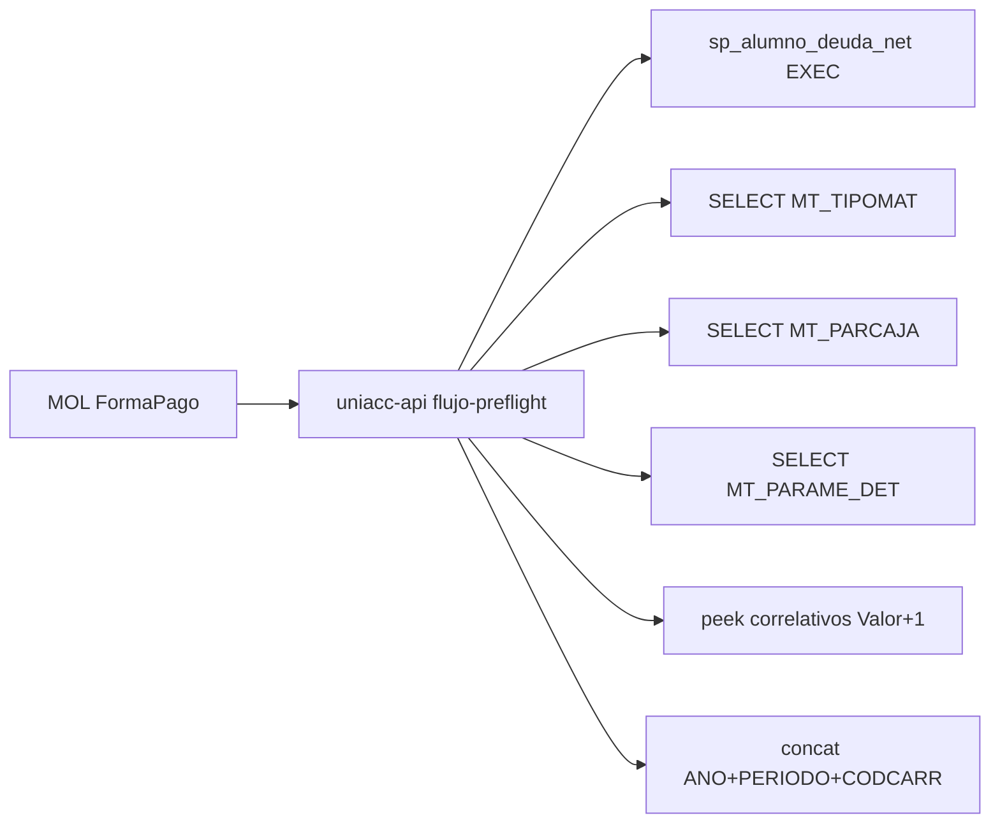

---

## Índice

- [Cómo anotar un SP nuevo](#cómo-anotar-un-sp-nuevo)
- Fichas
  - [`sp_alumno_deuda_net`](#sp_alumno_deuda_net)
  - [`pa08_MT_TIPOMAT_sel`](#pa08_mt_tipomat_sel)
  - [`pa08_MT_PARCAJA_sel`](#pa08_mt_parcaja_sel)
  - [`pa08_MT_PARAME_DET_value`](#pa08_mt_parame_det_value)
  - [`MT_PARAME_DET_save`](#mt_parame_det_save)
  - [`SP_GENERACORRELATIVOCONTRATO`](#sp_generacorrelativocontrato)
  - [`SP_VALIDA_PARAMETROS_CAJA`](#sp_valida_parametros_caja)
  - [`sp_parametro_transaccion_correlativo`](#sp_parametro_transaccion_correlativo)
- [Mencionados en MOL (sin ficha profunda)](#mencionados-en-mol-sin-ficha-profunda)
  - [`sp_lista_docpag_matricula_caja`](#sp_lista_docpag_matricula_caja)
  - [`pa08_MT_ARANCEL_sel_MATRICULA_NET`](#pa08_mt_arancel_sel_matricula_net)
- [Impresión de contrato (TRACE PROD)](#impresion-contrato-trace)
  - [`sp_impresion_contrato_vta`](#sp_impresion_contrato_vta)
  - [`pa08_MT_IMPRESION_in`](#pa08_mt_impresion_in)
  - [`SP_IMPRESION_INFORME`](#sp_impresion_informe)
- [Tabla resumen](#tabla-resumen)

---

<a id="cómo-anotar-un-sp-nuevo"></a>

## Cómo anotar un SP nuevo

Copiar esta ficha al final de la lista:

```md
### `nombre_real`

- **Planilla / alias:** …
- **Para qué:** …
- **Parámetros:** …
- **Devuelve:** …
- **¿Escribe?:** sí / no — …
- **MOL / uniacc-api:** …
- **Notas:** …

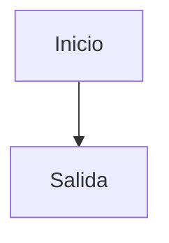
```

---

## Fichas

<a id="sp_alumno_deuda_net"></a>

### `sp_alumno_deuda_net`

- **Planilla / alias:** validación de deuda / bloqueo matrícula.
- **Para qué:** saber si el alumno tiene deuda que impide matricular (`@Opcion = 124`).
- **Parámetros:**
  - `@RUT` varchar — cuerpo sin DV
  - `@FECCAJA` datetime — en API: medianoche local
  - `@NoMostrar` smallint — default `0`
  - `@Opcion` int — **124** = bloqueo matrícula
- **Devuelve:** 1 result set, 1 columna `DEUDA` (numérico/string). Ej.: `{ "DEUDA": 0.0 }`. Sin deuda si `0` / vacío / `N` / `NO`.
- **¿Escribe?:** no (lectura).
- **MOL / uniacc-api:** EXEC real. `POST /api/rematricula/alumno/deuda-net`. Servicio [`alumno-deuda-net.service.ts`](/opt/uniacc-api-docker/src/services/alumno-deuda-net.service.ts). Gate en [`FormaPagoMockView.vue`](../src/views/matricula-mock/FormaPagoMockView.vue). También se incluye en el preflight.
- **Notas:** único EXEC permitido en el preflight. Usuario ERP necesita `GRANT EXECUTE` sobre el objeto.

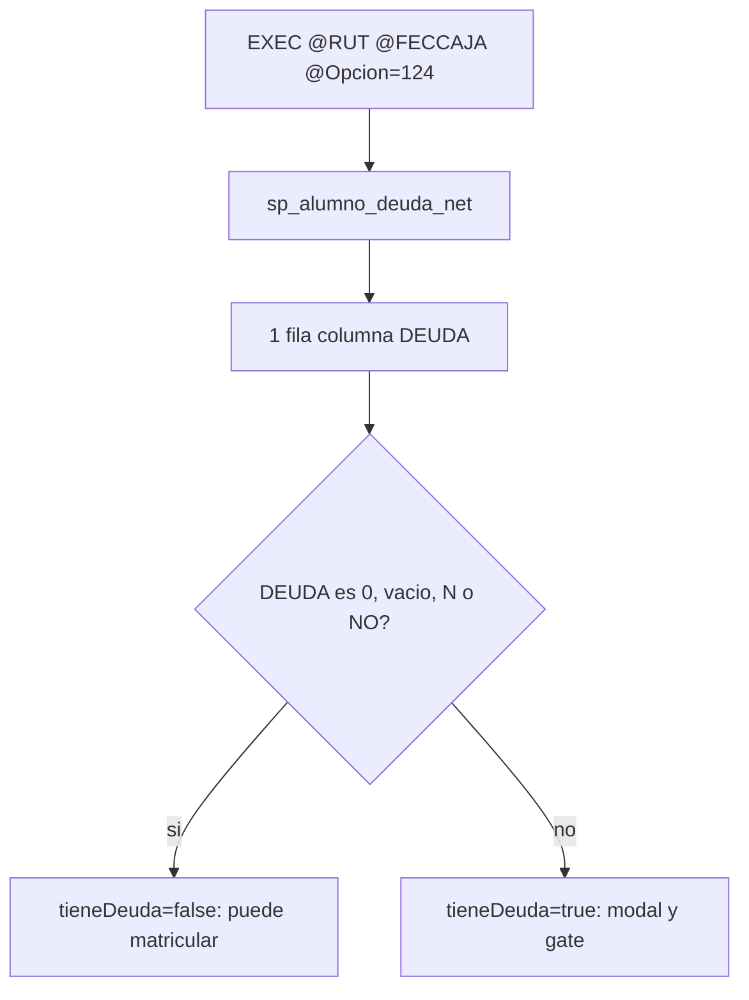

---

<a id="pa08_mt_tipomat_sel"></a>

### `pa08_MT_TIPOMAT_sel`

- **Planilla / alias:** valida tipo de matrícula (`MT_TIPOMAT`).
- **Para qué:** obtener vigencia / periodos del tipo de matrícula (p. ej. 12).
- **Parámetros:** todos opcionales (default 0 / `''`). Filtros dinámicos. En planilla: `@TIPOMAT=12`.
- **Devuelve:** filas de `MT_TIPOMAT` + `BinaryChecksum`. TIPOMAT 12 observado: `ANUAL ONLINE SMP`, `PERIODO_MAT=2`, `ANO_MAT=2026`, `PERIODOS=2`, `PERIODOSANUALES=2`.
- **¿Escribe?:** no. SELECT dinámico (`exec(@sqlstr)`).
- **MOL / uniacc-api:** no se EXEC. Equivalente:

```sql
SELECT TIPOMAT, DESCRIPCION, PERIODO_MAT, ANO_MAT, PERIODOS, PERIODOSANUALES
FROM dbo.MT_TIPOMAT WHERE TIPOMAT = @tipomat
```

`ok` si hay 1 fila.

- **Notas:** SP generado tipo “nómina” (Bettersoft).

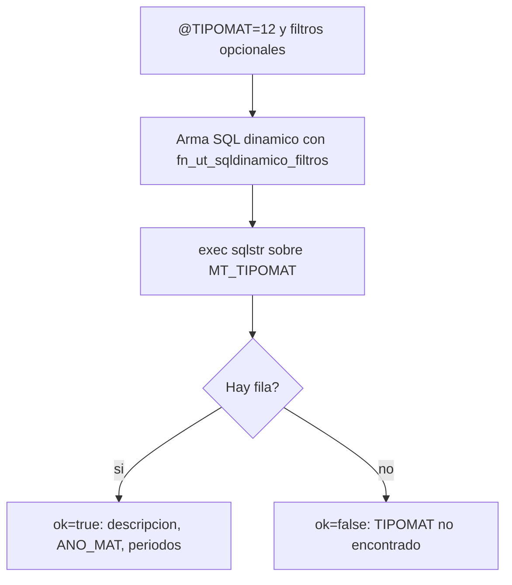

---

<a id="pa08_mt_parcaja_sel"></a>

### `pa08_MT_PARCAJA_sel`

- **Planilla / alias:** valida que la caja del usuario esté abierta.
- **Para qué:** no operar caja cerrada. Planilla: `@CAJA=10`, `@ABIERTA='S'`.
- **Parámetros:** muchos filtros opcionales (`@CAJA`, `@TIPO`, `@ABIERTA`, fechas, usuario, montos, cuadrada, etc.).
- **Devuelve:** join `MT_PARCAJA` + `MT_CAJA` + `BinaryChecksum`. 0 filas = caja no abierta con ese filtro.
- **¿Escribe?:** no.
- **MOL / uniacc-api:** no se EXEC. Equivalente: `TOP 1` donde `CAJA=@caja AND ABIERTA='S'` ordenado por `FECHA DESC`. `caja.ok` si hay fila.
- **Notas:** en TEST (ago 2026) caja 10 estuvo abierta (`ABIERTA=S`). En PROD había estado cerrada. El gate de pago depende del ambiente activo.

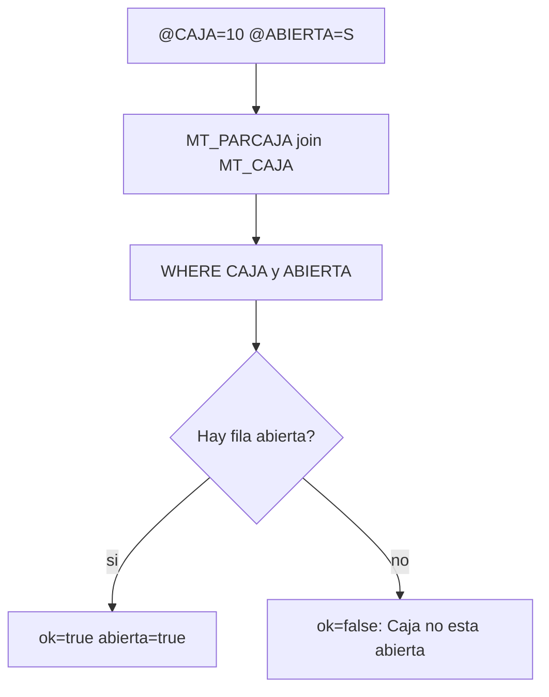

---

<a id="pa08_mt_parame_det_value"></a>

### `pa08_MT_PARAME_DET_value`

- **Planilla / alias:** `pa08_MT_PARAMET_DET_value` (typo). Saca valor de parámetro.
- **Para qué:** leer `CORRCONTRATO` (y cualquier `IdParametro`) vigente.
- **Parámetros:** `@IdParametro` varchar(30), `@FechaEvaluar` datetime — **comentado en el cuerpo**; filtra con `GETDATE()`.
- **Devuelve:** 1 columna `Valor`. `TOP 1 … ORDER BY NumLinea DESC` con fechas vigentes. Ejemplo CORRCONTRATO: `"61741"` / `"60587"` según ambiente.
- **¿Escribe?:** no.
- **MOL / uniacc-api:** helper `valorParame(id)` en [`matricula-flujo-preflight.service.ts`](/opt/uniacc-api-docker/src/services/matricula-flujo-preflight.service.ts) (misma lógica de fechas + `NumLinea DESC`).
- **Notas:** nombre real `PARAME` (una E), no `PARAMET`.

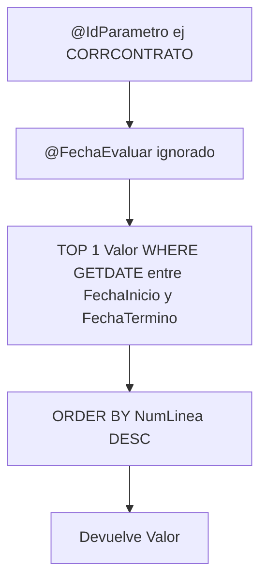

---

<a id="mt_parame_det_save"></a>

### `MT_PARAME_DET_save`

- **Planilla / alias:** `MT_PARAMET_DET_save`. Guarda valor.
- **Para qué:** persistir el correlativo de contrato (u otro) en la línea máxima de `IdParametro`.
- **Parámetros:** `@valor` varchar(10), `@IdParametro` varchar(30).
- **Devuelve:** nada útil (UPDATE).
- **¿Escribe?:** sí — `UPDATE MT_PARAME_DET SET Valor = @valor` donde `NumLinea = MAX` de ese parámetro.
- **MOL / uniacc-api:** **no se llama** en preflight. Reservado para cuando se consuma correlativo de verdad.
- **Notas:** no ejecutar en inspección.

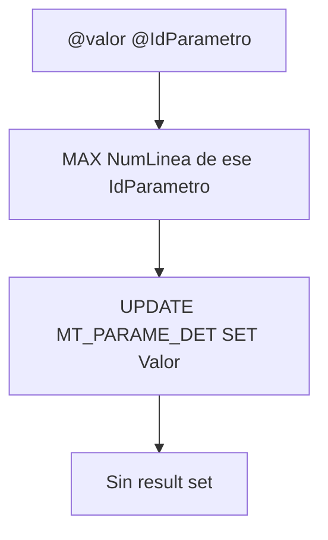

---

<a id="sp_generacorrelativocontrato"></a>

### `SP_GENERACORRELATIVOCONTRATO`

- **Planilla / alias:** genera campo contrato.
- **Para qué:** armar el string de contrato (no inserta filas).
- **Parámetros:** `@CORRELATIVO` varchar(10), `@CODCARR` varchar(30).
- **Devuelve:** 1 columna **sin nombre** = `ANOADMISION + PERIODOADMISION + CODCARR + CORRELATIVO` (vía `Fn_ValorParame`). Ej. test: `20261N11MU2AE60587`.
- **¿Escribe?:** no.
- **MOL / uniacc-api:** concatenación equivalente en preflight (`contrato.actual` / `contrato.preview` con corr+1).
- **Notas:** pymssql `as_dict=True` falla por columna sin nombre; el inspector reintenta sin dict.

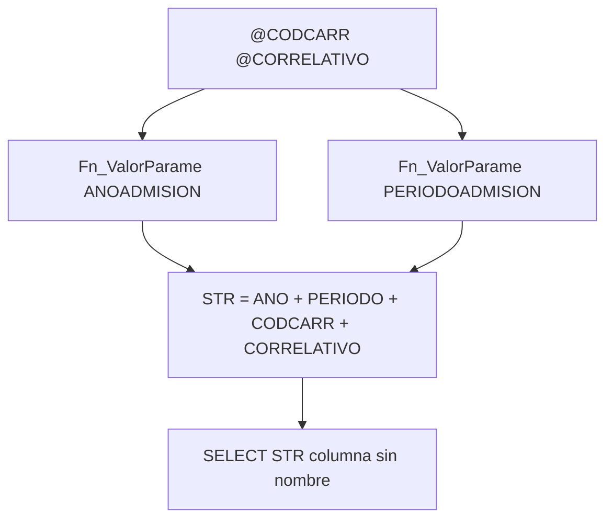

---

<a id="sp_valida_parametros_caja"></a>

### `SP_VALIDA_PARAMETROS_CAJA`

- **Planilla / alias:** valida parámetros de caja / grupo (`MT_CORRELATIVO`).
- **Para qué:** checklist de parámetros financieros antes de transaccionar. `@codgrupo` (planilla: 10).
- **Parámetros:** `@codgrupo` decimal(5,0).
- **Devuelve:** 1 columna sin nombre: mensaje vacío = OK; si falta algo, texto de error.
- **¿Escribe?:** **puede** `UPDATE FechaTermino` en `MT_PARAME_DET` si un parámetro está vacío/NULL (reabre vigencia). No es un SELECT puro.
- **MOL / uniacc-api:** no se EXEC. Checks ligeros de existencia: `CORRELATIVO`, `CORRCONTRATO`, `ANOADMISION`, `PERIODOADMISION`, `SECUENCIA`, `CORRPAGNUM` vigentes + `EXISTS MT_CORRELATIVO WHERE CODGRUPO=@codgrupo`.
- **Notas:** no usar para “solo mirar” si se quiere cero escrituras.

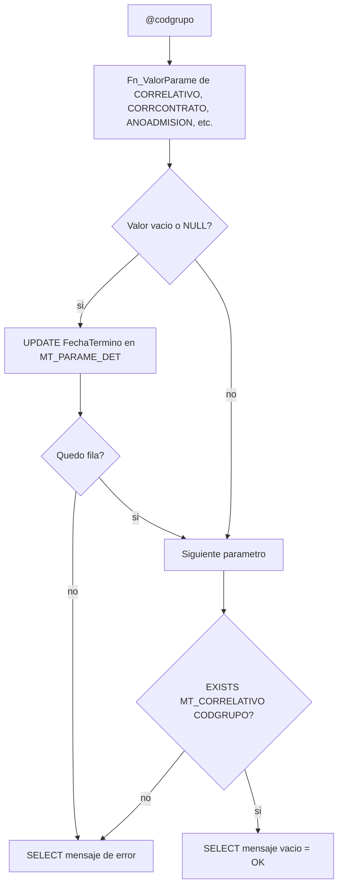

---

<a id="sp_parametro_transaccion_correlativo"></a>

### `sp_parametro_transaccion_correlativo`

- **Planilla / alias:** `SP_PARAMETRO_TRANSACCION_CORRELATIVO`. Genera `CTADOCNUM` / `CTATRANS` / num. operación / `CTAPAGNUM`.
- **Para qué:** correlativo único de transacción. Un `EXEC` = un número consumido.
- **Parámetros:**
  - `@tipo` varchar(50) — `'SECUENCIA'` | `'CORRELATIVO'` | `'CORRPAGNUM'` | otros
  - `@salida` decimal(20,0) OUTPUT
  - `@muestra` varchar(2) = `'SI'` → además `SELECT @salida` (columna sin nombre)
- **¿Escribe?:** **sí.** `BEGIN TRAN`; `UPDATE MT_PARAME_DET SET Valor = CONVERT(BIGINT, Valor) + 1` en la línea vigente de `@tipo`. Si el parámetro no existe, lo crea en `mt_parame_enc` / `MT_PARAME_DET`.
- **MOL / uniacc-api:** **no se EXEC.** Preflight: peek `actual` + `preview = actual + 1` (string/bigint). Cuotas pagaré usan `CORRELATIVO.preview` (etiqueta “no consumido”).
- **Notas:** no inspeccionar con EXEC. El ETL `inspect_sp.py` (prod `SQLSERVER_*`) es otro servidor que el switch MOL test/prod.

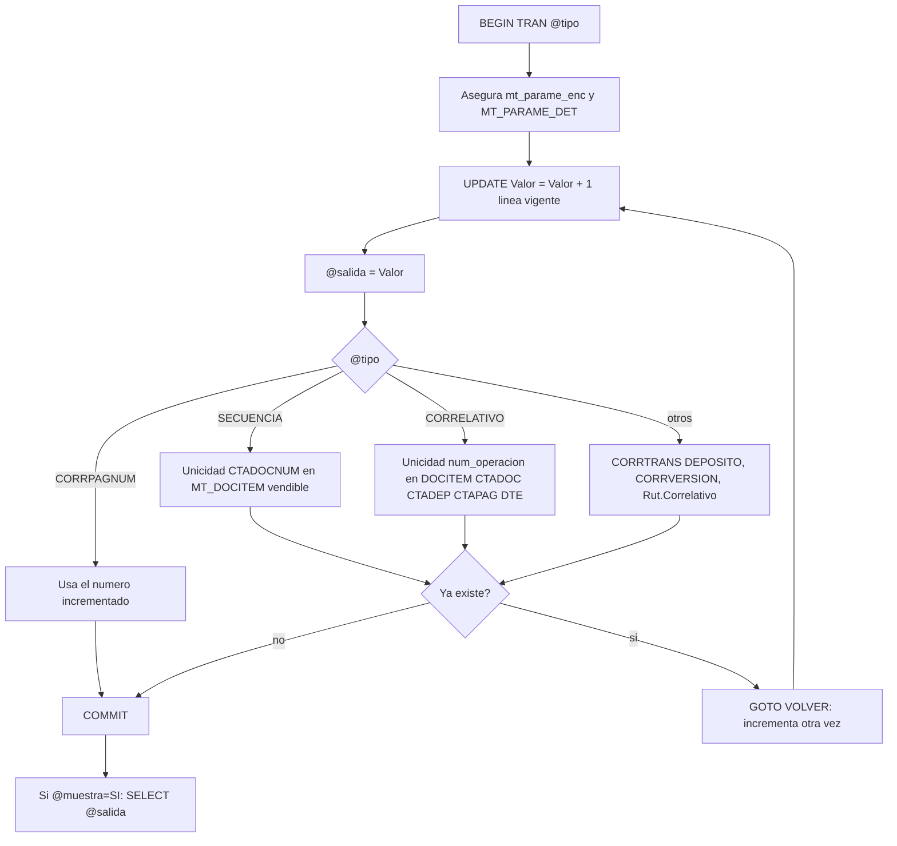

#### Rama `@tipo = 'SECUENCIA'`

Uso planilla: `CTADOCNUM` / `CTATRANS` ítem 1 (matrícula) e ítem 2 (arancel) → **dos EXEC = dos números**.

Tras incrementar, si ese valor ya existe como `MT_DOCITEM.CTADOCNUM` de un `MT_DOCUM` con `VENDIBLE='S'`, hace `GOTO VOLVER` e incrementa otra vez hasta hallar uno libre.

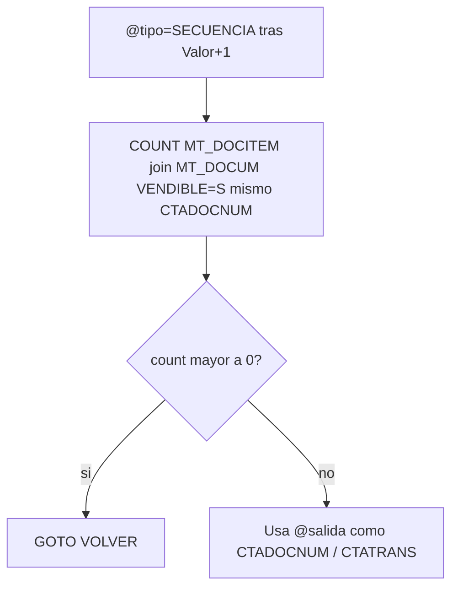

#### Rama `@tipo = 'CORRELATIVO'`

Número de operación. Tras incrementar, si `@salida` ya está en `MT_DOCITEM`, `MT_DTE_ENCABEZADO`, `MT_CTADOC`, `MT_CTADEP` o `MT_CTAPAG` (`num_operacion`), vuelve a incrementar. Si `MNP.RESERVAR.NUMOPER = 'SI'`, también valida tablas `*_RESERVA`.

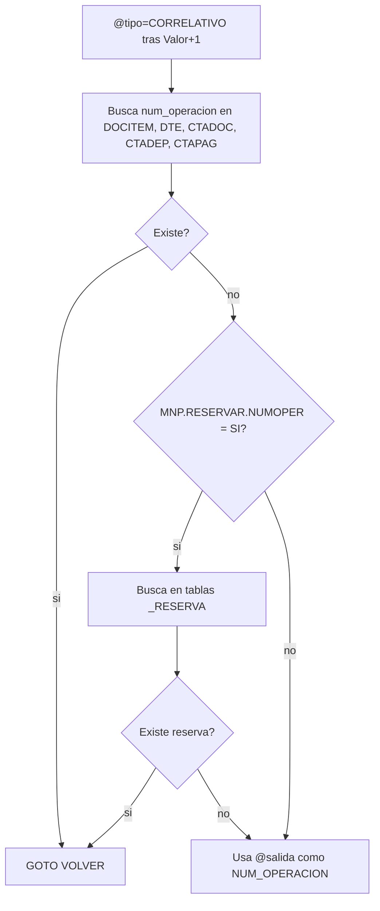

#### Rama `@tipo = 'CORRPAGNUM'` (planilla: `N°CORRPAGNUM`)

Mismo SP genérico (incremento + uniqueness del propio UPDATE). Planilla: correlativos de `CTAPAGNUM`; a veces `CTADOCNUM`/`CTATRANS` “desde” ese número. IdParametro real: **`CORRPAGNUM`**.

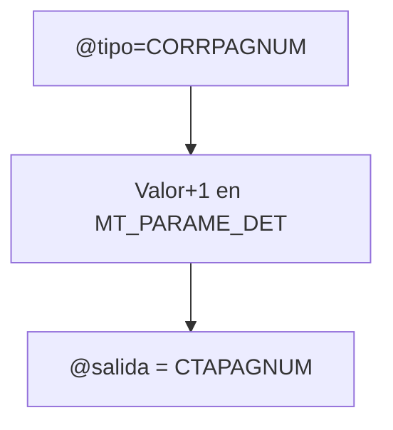

Otras ramas en el SP (no usadas aún en MOL): `CORRTRANS-DEPOSITO`, `CORRTRIBCIERRE`, `CORRVERSION`, `Rut.Correlativo`.

---

<a id="mencionados-en-mol-sin-ficha-profunda"></a>

## Mencionados en MOL (sin ficha profunda)

<a id="sp_lista_docpag_matricula_caja"></a>

### `sp_lista_docpag_matricula_caja`

Lista documentos de pago. Front: `@DESPLIEGA='M'` matrícula y `'A'` arancel. `POST /api/rematricula/docpag/lista-caja`. EXEC real. El pagaré en UI sigue fijo `tipodoc 5`.

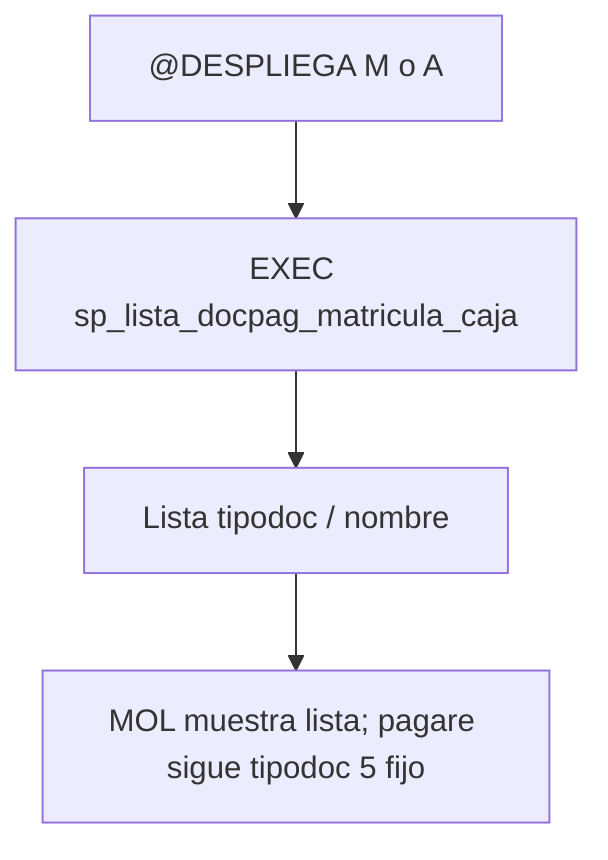

<a id="pa08_mt_arancel_sel_matricula_net"></a>

### `pa08_MT_ARANCEL_sel_MATRICULA_NET`

Montos matrícula/arancel vigentes. `POST /api/rematricula/arancel/matricula-net`. EXEC real. Params típicos: `CODCARR`, año, periodo, categoría, jornada.

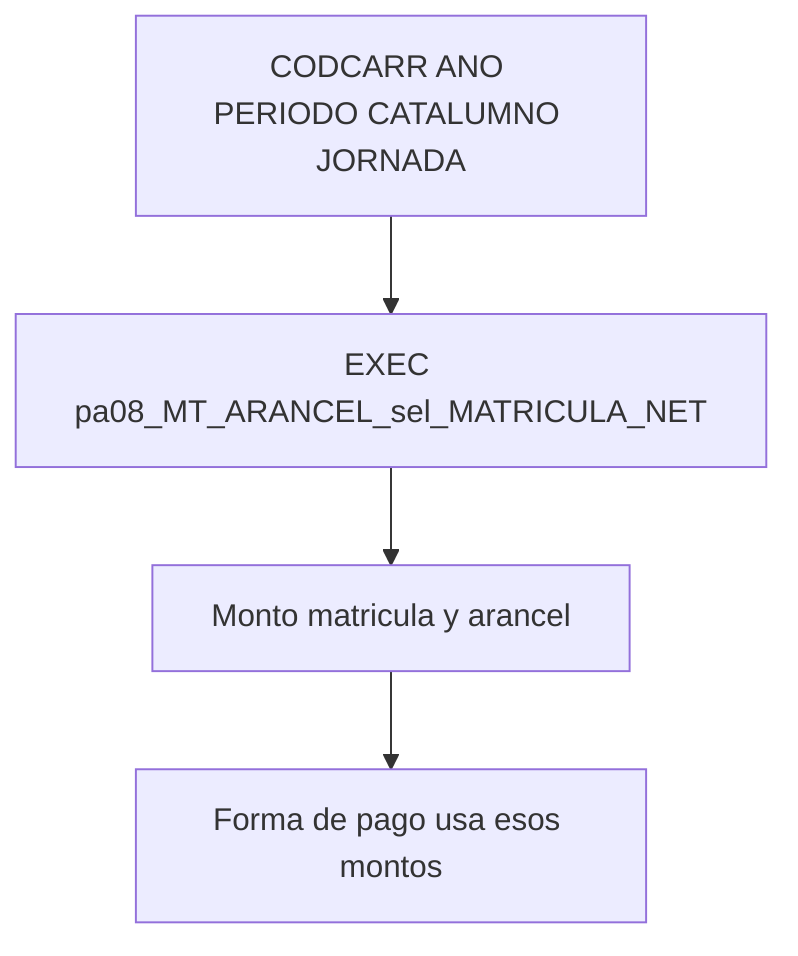

---

<a id="impresion-contrato-trace"></a>

## Impresión de contrato (TRACE PROD)

Fuente: `SELECT * FROM dbo.TRACE_22481393` en **PROD** `UNIACC` (2026-07-20 ~17:14–17:15). El sufijo del TRACE es el `CODCLI` (RUT sin DV) **22481393**. Operación **966662**, carrera **MUCO1DR**, caja **104**, usuario **59024**.

No es firma electrónica (Acepta/FES): es el pipeline U+ que **imprime el Crystal Report** del contrato. En TEST los SPs existen, pero la cola/motor de impresión (puntos, `.rpt`, consumidor de `MT_IMPRESION`) suele no estar operativa.

Formato usado en el TRACE: `MT_FMTIMP.CODFMT=1` → `CONTRATO_UNIACC.rpt`, `TIPODETALLE=COMPROMISOS`. Existe también `CODFMT=6` → `CONTRATO_MNP_UNIACC.RPT` (candidato MNP/MOL).

**Contrato MOL v1 (mock):** no usa motor RPT ni `SP_IMPRESION_INFORME`. Preview HTML + PDF (`POST /api/rematricula/alumno/contrato/preview-pdf`) con fixture de cláusulas ([`docs/contrato/`](contrato/campo-mapa.md)) y datos del alumno + plan de pagos confirmado en el flujo mock (paso Firma).

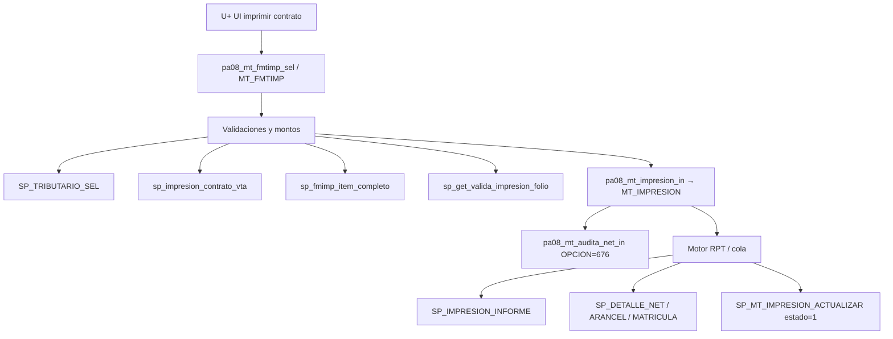

Ruido de fondo en el TRACE (ignorar al analizar el contrato): `SP_MT_IMPRESION_SEL_X_ESTADO` (polling puntos 9/104/245/273/305) y `sp_obtener_reportes` (cola `fw_procesa_reportes`).

Prep auxiliar observada: `pa08_mt_empresa_sel`, `pa08_mt_carrer_sel`, `pa08_mt_docum_sel`, `SP_TOTAL_NOTA_CREDITO`, `SP_MONTO_DSCTO_FACT_VENTA`, `pa08_mt_ctapag_sel`, `pa08_mt_ctadoc_sel`.

<a id="sp_impresion_contrato_vta"></a>

### `sp_impresion_contrato_vta`

- **Planilla / alias:** gate antes de imprimir contrato de venta.
- **Para qué:** comprobar si hay detalle de contrato facturado para la operación.
- **Parámetros:** `@num_operacion` numeric(22,0).
- **Devuelve:** `COUNT(*)` de `dbo.mt_contrato_fact_detalle` WHERE `NUM_OPERACION=@num_operacion`.
- **¿Escribe?:** no.
- **MOL / uniacc-api:** no. **No genera el PDF**; solo el conteo.
- **Notas:** en el TRACE: `sp_impresion_contrato_vta '966662'`.

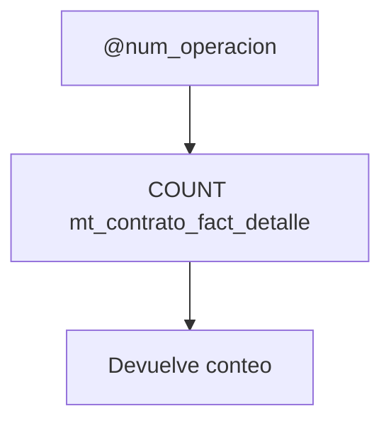

<a id="pa08_mt_impresion_in"></a>

### `pa08_MT_IMPRESION_in`

- **Planilla / alias:** encola trabajo de impresión en `MT_IMPRESION`.
- **Para qué:** registrar impresora, formato, RPT, alumno, operación, caja; el motor de reportes lo consume después.
- **Parámetros (TRACE contrato):** `@impresora='Microsoft Print to PDF'`, `@tipo_informe='rpt'`, `@usuario='59024'`, `@punto_impre='9'`, `@CODFMT=1`, `@RPTFILE='CONTRATO_UNIACC.rpt'`, `@CODCLI`, `@CODCARR`, `@NUM_OPERACION`, `@CAJA`, `@FECHACAJA`, `@TIPODETALLE='COMPROMISOS'`.
- **Devuelve:** insert; si `@CODFMT<>0` completa `RPTFILE` / tipo / copias desde `MT_FMTIMP`.
- **¿Escribe?:** sí — `MT_IMPRESION` (+ control de cambios).
- **MOL / uniacc-api:** no integrado.
- **Notas:** auditoría asociada `pa08_mt_audita_net_in` con **OPCION=676** (“Envía impresión…”). Cierre posterior: `SP_MT_IMPRESION_ACTUALIZAR @estado=1`.

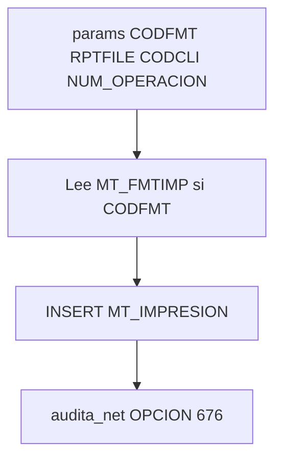

<a id="sp_impresion_informe"></a>

### `SP_IMPRESION_INFORME`

- **Planilla / alias:** dataset del Crystal Report.
- **Para qué:** armar los result sets que alimentan el `.rpt` según `@CODFMT`.
- **Parámetros:** `@CODCLI`, `@CODCARR`, `@CTADOC` (0 → NULL), `@NUM_OPERACION`, `@CODFMT`.
- **Devuelve:** múltiples result sets (SP muy grande, ~1.5 MB en PROD). Según formato puede ramificar por `TIPODETALLE` de `MT_FMTIMP`.
- **¿Escribe?:** puede (p. ej. log de certificados si el formato `REQUIEREVALIDACION='SI'`); para contrato `CODFMT=1` el TRACE no exige validación (`REQUIEREVALIDACION=NO`).
- **MOL / uniacc-api:** no.
- **Notas:** en el TRACE, tras encolar, el motor llama `SP_IMPRESION_INFORME @CODCLI='22481393',@CODCARR='MUCO1DR',@CTADOC=0,@NUM_OPERACION=966662,@CODFMT=1` y luego `SP_DETALLE_NET` / `SP_DETALLE_ARANCEL_2_NET` / `SP_DETALLE_MATRICULA_NET` con `@TIPODETALLE='COMPROMISOS'`.

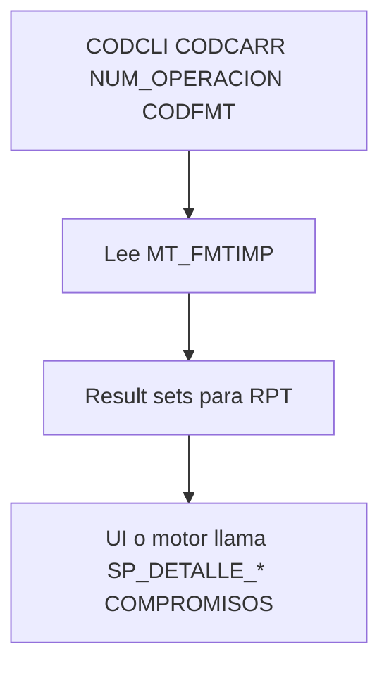

---

<a id="tabla-resumen"></a>

## Tabla resumen

| SP | Lectura / escritura | MOL hoy |
| --- | --- | --- |
| `sp_alumno_deuda_net` | Lectura | EXEC (`deuda-net` + preflight) |
| `pa08_MT_TIPOMAT_sel` | Lectura | SELECT equivalente (preflight) |
| `pa08_MT_PARCAJA_sel` | Lectura | SELECT equivalente (preflight) |
| `pa08_MT_PARAME_DET_value` | Lectura | SELECT `valorParame` (preflight) |
| `MT_PARAME_DET_save` | **UPDATE** | No llamar |
| `SP_GENERACORRELATIVOCONTRATO` | Lectura (concat) | Concat equivalente (preflight) |
| `SP_VALIDA_PARAMETROS_CAJA` | Lectura + **posible UPDATE** | Checks existencia (preflight) |
| `sp_parametro_transaccion_correlativo` | **UPDATE +1** | Peek/preview solamente |
| `sp_lista_docpag_matricula_caja` | Lectura | EXEC lista-caja |
| `pa08_MT_ARANCEL_sel_MATRICULA_NET` | Lectura | EXEC matricula-net |
| `sp_impresion_contrato_vta` | Lectura (COUNT) | No — gate impresión U+ |
| `pa08_MT_IMPRESION_in` | **INSERT** `MT_IMPRESION` | No |
| `SP_IMPRESION_INFORME` | Lectura (+ posible log certif.) | No — dataset RPT |
| `SP_MT_IMPRESION_ACTUALIZAR` | **UPDATE** estado impresión | No |
