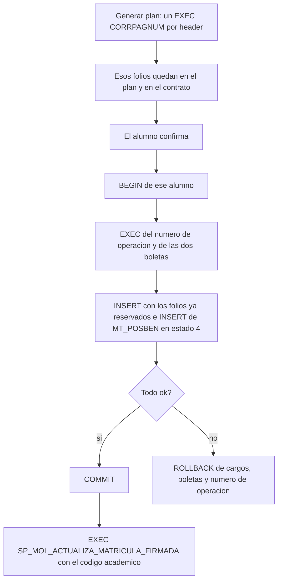

# Grabar el plan de pagos en el ERP

Para revisar con el equipo. Fecha: 2026-10-02.

Este documento dice cómo grabaría MOL la cuenta corriente en U+. Los alumnos, folio por folio y con su fila de `MT_POSBEN`, están en [`casuisticas-cartera-posben.md`](casuisticas-cartera-posben.md).

No es el SP. No hay `INSERT` ni `EXEC` en este paso.

Otras referencias: [`plan-pagos-correlativos.md`](../plan-pagos-correlativos.md), [`matricula-escritura-tablas.md`](../matricula-escritura-tablas.md), [`Analisis_SP.md`](../Analisis_SP.md#sp_parametro_transaccion_correlativo).

---

## 1. Cómo leerlo

1. Esta nota: la transacción, el orden de los folios y lo que falta cerrar.
2. [Los nueve casos](casuisticas-cartera-posben.md): un alumno por sección, con los documentos y la fila de `MT_POSBEN`.

`codcli` en U+ es el RUT sin dígito verificador. El código académico va en `contrato`.

---

## 2. Ya cerrado

| Tema | Decisión |
| --- | --- |
| Cuándo se graba | Una transacción por alumno, al confirmar. |
| Varios alumnos a la vez | Cada uno tiene su transacción. No va un lote de alumnos en la misma llamada, ni una llamada por cada fila. |
| El peek de la pantalla | Se reserva al generar el plan: un `EXEC` de `CORRPAGNUM` por cada header. Esos folios son los de la pantalla, los del contrato y los que el SP inserta. |
| Orden de los folios | Como el [caso 2](casuisticas-cartera-posben.md#caso-2-matrícula-cubierta-al-100) y el [caso 9](casuisticas-cartera-posben.md#caso-9-referencia-del-orden-de-folios). Primero el pagaré del saldo. Después los descuentos. Si un descuento cubre el 100 % de la matrícula, ese pagaré no se pide. |
| El beneficio | MOL inserta la fila en `MT_POSBEN` con estado 4, `APROBADO` S, `num_operacion`, `FECASIG` y el monto aplicado. Una fila por cada `CODBEN`. Si el plan no trae beneficios, no inserta nada. |

Hoy el botón de generar plan solo lee `Valor + 1` y el navegador suma el resto. Con la decisión de arriba, ese clic pasa a reservar cada folio.

Un plan abandonado, o un segundo clic en generar, deja huecos: esos `CORRPAGNUM` ya se consumieron. El `num_operacion` y las dos boletas 41 se piden recién al confirmar, dentro de la transacción. Si el grabado falla, esos dos vuelven atrás. Los folios del plan no.



El `COMMIT` cierra los pagarés. Recién ahí MOL llama a `SP_MOL_ACTUALIZA_MATRICULA_FIRMADA`. El parámetro es el código académico de `MT_ALUMNO.CODCLI` (`varchar(20)`), no el RUT que usa el plan. En la prueba de Valentina es `20201TRIE1DR056`.

Esa llamada va aparte. El procedimiento de ficha abre su propia transacción y, si falla, hace `ROLLBACK`. Metido dentro del plan, ese rollback desharía también los pagarés. Si la ficha falla y el plan ya confirmó, los pagarés quedan y se reintenta solo la segunda llamada, con el mismo código.

Actualiza esa fila de `MT_ALUMNO`:

- `ANO_MAT = 2027`
- `PERIODO_MAT = 1`
- `PERIODOS = 2`
- `FEC_MAT = GETDATE()`

El año, el periodo y `PERIODOS` van fijos en el procedimiento. Devuelve un `SELECT` con `RESULTADO` `OK` o `ERROR`. No hace `THROW`. Si el código no está en `MT_ALUMNO`, no cambia nada. Existe en U+ Test. En producción todavía no está.

```sql
EXEC SP_MOL_ACTUALIZA_MATRICULA_FIRMADA
    @CODCLI = '20201TRIE1DR056';
```

---

## 3. Qué hace el SP

Nombre propuesto: `sp_mol_grabar_plan_pagos`. Una llamada por alumno.

1. Recibe los `CORRPAGNUM` ya reservados. No vuelve a pedirlos.
2. Abre la transacción.
3. Pide `CORRELATIVO` (el `num_operacion`) y dos `SECUENCIA` (boleta de matrícula y boleta de arancel).
4. Inserta `MT_DOCITEM`, las boletas 41, los `MT_CTAPAG`, las cuotas y los `MT_CTADEP`. Las cuotas cuelgan del header: `90121320816` → `9012132081601` … `10`. No piden otro número.
5. Inserta cada beneficio del plan en `MT_POSBEN` con estado 4 y el `num_operacion` recién pedido. Ver [cómo se marca el beneficio](casuisticas-cartera-posben.md#cómo-se-marca-el-beneficio).
6. Commit. Si algo falla, rollback y el error vuelve al API. MOL no marca la matrícula como grabada.
7. Si el commit salió bien, `SP_MOL_ACTUALIZA_MATRICULA_FIRMADA` con el código académico. Un error ahí no revierte el plan.

El esqueleto, sin el detalle de columnas, está en [`matricula-escritura-tablas.md`](../matricula-escritura-tablas.md):

```sql
CREATE PROCEDURE dbo.sp_mol_grabar_plan_pagos
    @codcli varchar(20), @codcarr varchar(20),
    @ano int, @periodo int, @contrato varchar(40),
    @caja int, @usuario varchar(20)
AS
BEGIN
    SET NOCOUNT ON;
    SET XACT_ABORT ON;

    DECLARE @num_operacion decimal(20,0);
    DECLARE @ctadoc_matricula decimal(20,0);
    DECLARE @ctadoc_arancel decimal(20,0);

    BEGIN TRY
        BEGIN TRAN;

        EXEC dbo.sp_parametro_transaccion_correlativo
            @tipo = 'CORRELATIVO', @salida = @num_operacion OUTPUT, @muestra = 'NO';
        EXEC dbo.sp_parametro_transaccion_correlativo
            @tipo = 'SECUENCIA', @salida = @ctadoc_matricula OUTPUT, @muestra = 'NO';
        EXEC dbo.sp_parametro_transaccion_correlativo
            @tipo = 'SECUENCIA', @salida = @ctadoc_arancel OUTPUT, @muestra = 'NO';

        -- Cargos: DOCITEM + boleta 41 de matricula, luego los del arancel.
        -- Pagos, en el orden reservado: pagare del saldo, despues cada descuento.
        -- Cuotas del pagare: folio + 01 .. N. Un CTADEP por boleta + folio.

        INSERT INTO dbo.MT_POSBEN (
            CODBEN, ORDEN, CODCLI, CODCARR, ANO, PERIODO,
            APROBADO, APLICABLE, USUARIO, ESTADO, FECASIG, MONTO, num_operacion
        )
        SELECT
            b.codben, 1, @codcli, @codcarr, @ano, @periodo,
            'S', 1, @usuario, 4, /* fecha de la matricula, 00:00 */,
            b.monto, @num_operacion
        FROM @beneficios b;

        COMMIT TRAN;
    END TRY
    BEGIN CATCH
        IF XACT_STATE() <> 0 ROLLBACK TRAN;
        THROW;
    END CATCH
END
```

`sp_parametro_transaccion_correlativo` abre su propia transacción. Llamado adentro de esta, su `COMMIT` no cierra la de afuera: el rollback se lleva también el `num_operacion` y las boletas. Los `CORRPAGNUM` se reservaron antes, cada uno con su propio `COMMIT`, y quedan consumidos.

---

## 4. Los casos

Universo del cruce: 4.103 RUT rematriculables de la cartera 2027-1, fuera de SUBDERE. Todos tienen matrícula 2026 en U+: 4.180 operaciones. Seis firmas suman 2.057. Las otras 2.123 son combinaciones distintas y no están re-sumadas.

| | Caso | Operaciones | Pagaré de matrícula | Beneficio en `MT_POSBEN` |
| --- | --- | ---: | --- | --- |
| 1 | [Dos pagarés, cada uno con beca](casuisticas-cartera-posben.md#caso-1-dos-pagarés-cada-uno-con-beca) | 618 | Sí, por el saldo | 1744 en arancel y 2028 en matrícula |
| 2 | [Matrícula cubierta al 100 %](casuisticas-cartera-posben.md#caso-2-matrícula-cubierta-al-100) | 517 | No | 1791 en matrícula y 1756 en arancel |
| 3 | [Matrícula a precio pleno](casuisticas-cartera-posben.md#caso-3-matrícula-a-precio-pleno) | 458 | Sí, valor pleno | Solo 1744 en arancel |
| 4 | [Dos becas en el arancel](casuisticas-cartera-posben.md#caso-4-dos-becas-en-el-arancel) | 194 | No | 1791, 1756 y 1811. Un folio por cada una |
| 5 | [CAE con descuento de matrícula](casuisticas-cartera-posben.md#caso-5-cae-con-descuento-de-matrícula) | 186 | Sí, por el saldo | 2025, 1756 y CAE 4 (documento 21, `APLICABLE` 2) |
| 6 | [CAE y matrícula a precio pleno](casuisticas-cartera-posben.md#caso-6-cae-y-matrícula-a-precio-pleno) | 84 | Sí, valor pleno | CAE 4 y 1756. Sin fila de matrícula |
| 7 | [Cheques y descuento de matrícula](casuisticas-cartera-posben.md#caso-7-cheques-y-descuento-de-matrícula) | — | No | Solo 2025. El 3 % (tipo 20) no es beneficio |
| 8 | [Sin beneficio](casuisticas-cartera-posben.md#caso-8-sin-beneficio) | — | No | Ninguna fila en 2026 |
| 9 | [Referencia del orden de folios](casuisticas-cartera-posben.md#caso-9-referencia-del-orden-de-folios) | — | No | Solo 2028. Retiro Definitivo, fuera de la cartera |

En el caso 1 los dos pagarés van primero y las becas después. En el caso 4 el monto del folio puede ser menor que `MONTO_SOL`: se graba el monto aplicado.

---

## 5. Para cerrar en la revisión

1. **Un folio por beca.** En el [caso 4](casuisticas-cartera-posben.md#caso-4-dos-becas-en-el-arancel) hay dos becas de arancel y dos folios 373. Confirmar que el SP hace lo mismo, y no junta las becas del ítem en un solo header.
2. **Beca estatal y convenio.** En estos casos la beca interna y el descuento de matrícula son tipo 373, y el CAE es tipo 21. Estatal y convenio no aparecen en los nueve casos.
3. **CAE y el pagaré del alumno.** En los [casos 5 y 6](casuisticas-cartera-posben.md#caso-5-cae-con-descuento-de-matrícula) el documento 21 usa `MONTO`, que es menor que lo pedido, y no queda un pagaré 5 por el saldo del arancel. MOL hoy no resta el CAE del pagaré del alumno. Hay que fijar el monto antes de grabar.
4. **Cheques, redcompra, tarjeta y depósito.** Aparecen en la cartera y quedan fuera de esta primera versión. Su número no es `CORRPAGNUM`. El [caso 7](casuisticas-cartera-posben.md#caso-7-cheques-y-descuento-de-matrícula) y el [caso 8](casuisticas-cartera-posben.md#caso-8-sin-beneficio) son el ejemplo.
5. **Alcance.** Esta versión cubre cargos, pagos, cruces, cuotas y `MT_POSBEN`. El cierre de `MT_ALUMNO` (`ANO_MAT`, `PERIODO_MAT`, `PERIODOS`, `FEC_MAT`) es la segunda llamada, después del commit. Siguen fuera `MATRICULADO`, `MT_HISTMAT` y el control de matrícula.
