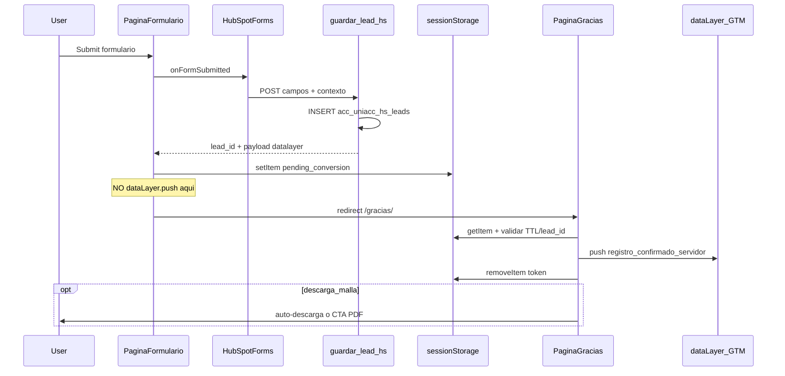

# Plan técnico ejecutivo: conversión en `/gracias/`

## Problema y objetivo

**Hoy:** el evento `registro_confirmado_servidor` se dispara en la **página del formulario** (hero, malla, legacy), antes del redirect. Marketing reporta distorsión histórica de conversiones; el stakeholder pide contar **solo en thank you page**.

**Objetivo:** una conversión = un lead guardado en BD + **un único** `dataLayer.push` en `/gracias/`, nunca en submit ni en refresh directo de gracias.

**Decisión de alcance (confirmada):** descarga de malla **también** pasa por `/gracias/` (cambia UX actual: ya no PDF+toast en la misma página).

---

## Arquitectura objetivo



### Principios de diseño

| Regla | Implementación |
|-------|----------------|
| Single source of fire | Solo [`hs-gracias-conversion.js`](file:///usr/share/nginx/public_html/wp-content/themes/AstraChildTheme/assets/js/hs-gracias-conversion.js) (nuevo) hace `dataLayer.push` |
| Anti doble conteo | Token consumido al disparar; refresh de `/gracias/` no re-dispara |
| Anti acceso directo | Sin token válido → sin evento |
| Payload intacto | Mismo shape que hoy arma PHP en [`HS-Leads-Ajax.php`](file:///usr/share/nginx/public_html/wp-content/themes/AstraChildTheme/functions/HS-Leads-Ajax.php) |
| Distinción hero vs malla | Campo `form_context` / `form_id` ya existente en payload (`formulario_general` vs `formulario_descarga_malla`) |

---

## Contrato `sessionStorage`

**Clave:** `uniacc_hs_pending_conversion`

**Valor (JSON):**

```javascript
{
  "v": 1,
  "lead_id": 12345,
  "created_at": 1735123456789,
  "ttl_ms": 600000,
  "payload": {
    "event": "registro_confirmado_servidor",
    "lead_id": 12345,
    "tecnologia": "php_custom",
    "form_id": "formulario_general",
    "form_context": "carrera_hero",
    "nombre": "...",
    "email": "...",
    "programa_codigo": "...",
    "current_url": "..."
  },
  "extras": {
    "download_url": "https://.../malla.pdf"
  }
}
```

- `ttl_ms`: 10 minutos recomendado (evita conversiones “fantasma” si el usuario vuelve horas después).
- `extras.download_url`: solo flujo malla; usado en gracias para descarga/CTA.
- Validación mínima en gracias: `v === 1`, `lead_id` numérico > 0, `payload.event === 'registro_confirmado_servidor'`, no expirado.

---

## Cambios por archivo (child theme prod/QA)

Ruta base: `/usr/share/nginx/public_html/wp-content/themes/AstraChildTheme/`

### 1. Nuevo: `assets/js/hs-gracias-conversion.js`

Responsabilidades:

1. Ejecutar **solo** en páginas thank you (ver enqueue).
2. Leer y validar token de `sessionStorage`.
3. `window.dataLayer = window.dataLayer || []`; `dataLayer.push(payload)`.
4. Borrar token inmediatamente después del push.
5. Si `extras.download_url` existe:
   - Mostrar bloque UI “Tu malla está lista” con enlace directo.
   - Intentar `window.open(download_url, '_blank')` **después** del push (o botón explícito si popup blocker bloquea).
6. Log de debug opt-in: `[UNIACC HS] conversion fired lead_id=N`.

**No** incluir PII en logs de producción.

### 2. Modificar: `assets/js/hs-native-forms.js`

En el handler post-éxito de `saveLead` / `onFormSubmitted`:

| Antes | Después |
|-------|---------|
| `dataLayer.push(response.datalayer)` | `sessionStorage.setItem(...)` con payload del servidor |
| Redirect ~2s después | Redirect a `redirectUrl` (default `/gracias/`) tras guardar token; delay opcional 300–500ms solo por UX |

API interna sugerida:

```javascript
uniaccHsNative.queueConversionForGracias(payload, extras)
uniaccHsNative.redirectToGracias(url) // default /gracias/
```

Flag de compatibilidad temporal (recomendado para rollout):

```javascript
// uniaccHsNativeVars.fireOnSubmit = false  // prod objetivo
```

Permite rollback rápido sin revertir todo el deploy.

### 3. Modificar: `assets/js/hs-malla-modal.js`

Cambios clave por decisión de negocio:

| Antes | Después |
|-------|---------|
| `redirectUrl: false` | `redirectUrl: '/gracias/'` |
| PDF en modal + toast en misma página | Guardar `download_url` en `extras` del token antes del redirect |
| `dataLayer.push` en modal | Eliminar; delegar a gracias |

Flujo malla propuesto:

1. Usuario confirma descarga → submit HS en modal.
2. AJAX OK → token con `form_context: descarga_malla`, `form_id: formulario_descarga_malla`, `download_url`.
3. Redirect a `/gracias/`.
4. Gracias dispara conversión + entrega PDF.

**Nota UX:** coordinar copy en página `/gracias/` para malla (Elementor): mensaje de descarga visible; evitar depender solo de popup.

### 4. Modificar: `assets/js/scripts.js` (legacy `#formContact`)

Función afectada: `pushRegistroConfirmadoHsOnly` (y callers pre-redirect).

- Dejar de hacer `dataLayer.push` inmediato.
- Escribir el mismo token `sessionStorage` (payload puede seguir siendo cliente-side con `lead_id` sintético `hs_client_*` **solo legacy**, o mejor: unificar legacy para que también pase por AJAX si aplica).
- Mantener redirect a `/gracias/`.

Prioridad: **HS nativo primero**; legacy en misma PR solo si marketing aún usa `#formContact` visible en alguna URL prod.

### 5. Modificar: `functions/Core.php`

```php
// Enqueue hs-gracias-conversion.js SOLO en thank you pages
add_action('wp_enqueue_scripts', 'enqueue_hs_gracias_conversion', 6);
function enqueue_hs_gracias_conversion() {
    if (!is_page(array('gracias'))) { // ampliar slugs si aplica
        return;
    }
    wp_enqueue_script(
        'hs-gracias-conversion',
        get_stylesheet_directory_uri() . '/assets/js/hs-gracias-conversion.js',
        array('tracking-manager', 'hs-native-forms'), // o solo tracking-manager
        '20260829a',
        true
    );
}
```

Bump de versión cache-bust en:

- `hs-native-forms.js` → `20260829a`
- `hs-malla-modal.js` → `20260829a`

### 6. Sin cambios funcionales: `functions/HS-Leads-Ajax.php`

El endpoint `guardar_lead_hs` **sigue** devolviendo el objeto `datalayer` en JSON. Solo cambia **quién** lo consume (gracias, no form page).

Verificar que la respuesta incluya siempre:

- `success`, `lead_id`, `datalayer` (objeto completo).

### 7. Página WordPress `/gracias/` (Elementor)

Contenido editorial mínimo:

- Mensaje genérico de postulación.
- Bloque condicional (HTML widget o shortcode) para malla: “Si descargaste una malla, revisa tu descarga abajo” — puede ser estático; el JS inyecta el link si hay `download_url`.

Opcional futuro: shortcode `[uniacc_hs_gracias_malla]` renderizado por PHP.

---

## Coordinación GTM (Go Point) — gate obligatorio

Deploy código **sin** este paso deja conversiones en cero o duplicadas.

| Acción | Detalle |
|--------|---------|
| Retirar tags/triggers | Que escuchen submit, HS events, o `registro_confirmado_servidor` en URLs de carrera |
| Nuevo trigger | Custom Event `registro_confirmado_servidor` **y** Page Path contiene `/gracias/` (defensa en profundidad) |
| Variables | Mantener mismas DL variables (`lead_id`, `form_id`, `programa_codigo`, UTMs) |
| QA en Preview | 1 hero + 1 malla + acceso directo `/gracias/` (debe **no** disparar) |

Ventana de deploy coordinada:

1. Publicar GTM en modo pausa/draft tags viejos.
2. Deploy código WP.
3. Smoke test.
4. Activar tags nuevos; desactivar viejos.

---

## Matriz de flujos post-implementación

| Flujo | BD local | Evento GTM | Destino | PDF |
|-------|----------|------------|---------|-----|
| Hero HS nativo | Sí | `/gracias/` | `/gracias/` | N/A |
| Malla modal HS | Sí | `/gracias/` | `/gracias/` | Desde gracias (`download_url`) |
| Legacy `#formContact` | Según CRM actual | `/gracias/` | `/gracias/` | N/A |
| Acceso directo `/gracias/` | No | **No** | — | No |
| Refresh `/gracias/` post-conversión | No | **No** (token consumido) | — | No |
| `/admision/` form | Sí | `/gracias/` | `/gracias/` | N/A |
| Beca Talento (`/gracias-beca-talento/`, etc.) | Fuera de scope v1 | Evaluar v2 | URLs distintas | — |

---

## Plan de despliegue

### Fase 0 — Preparación (1 día)

- Backup en servidor: `.bak.20260829` de JS + `Core.php`.
- Confirmar slug/page ID de `/gracias/` en prod y QA.
- Go Point confirma plan GTM.

### Fase 1 — QA (`qa3-uniacccl`)

1. Subir 3 JS + patch `Core.php`.
2. Purga cache nginx/Redis QA.
3. Pruebas:

| # | Caso | Esperado |
|---|------|----------|
| 1 | Hero carrera (ej. Ing. Comercial) | 1 evento en gracias; 0 en página form |
| 2 | Descarga malla | Redirect gracias + PDF/link; `form_id=formulario_descarga_malla` |
| 3 | `/gracias/` directo | Solo pageview |
| 4 | Refresh gracias tras conversión | Sin segundo evento |
| 5 | INSERT BD | Fila en `acc_uniacc_hs_leads` con `lead_id` del evento |

### Fase 2 — Producción (`uniacccl-prod`)

- Mismo patch; versión assets `20260829a`.
- Purga cache prod (fastcgi + Redis, según [deploy doc](file:///opt/mol-docker/docs/formularios-hubspot-nativos-prod-deploy.md)).
- Smoke en 2 carreras + 1 malla + `/admision/`.
- Monitoreo 24–48h: comparar conteo GTM vs filas BD (`lead_id`).

### Rollback

- Restaurar `.bak` JS + `Core.php`.
- Reactivar tags GTM antiguos.
- Tabla BD no se toca.

---

## Riesgos y mitigaciones

| Riesgo | Mitigación |
|--------|------------|
| Doble redirect (HubSpot + JS) | En forms malla/hero: preferir redirect JS post-AJAX; HS con inline message o redirect alineado a `/gracias/` |
| `sessionStorage` no disponible | Fallback conservador: no disparar conversión + log; lead igual queda en BD |
| Popup blocker PDF en gracias | Link visible + botón “Descargar malla”; no depender solo de `window.open` |
| Legacy aún dispara en submit | Auditar `scripts.js`, `CRM.php`; grep `registro_confirmado_servidor` en theme |
| Conteo cae a cero por GTM desincronizado | Deploy coordinado con Go Point; preview obligatorio |

---

## Criterios de éxito

- Cero `registro_confirmado_servidor` en Network/consola de **página formulario** (hero y malla).
- Exactamente **uno** por visita legítima a `/gracias/` post-submit.
- `lead_id` del evento = `id` en `acc_uniacc_hs_leads`.
- Malla: usuario llega a gracias y puede obtener PDF.
- Marketing valida en GTM Preview + reportes (48h).

---

## Orden de implementación (cuando apruebes Agent mode)

1. Crear `hs-gracias-conversion.js` + enqueue condicional en `Core.php`.
2. Refactor `hs-native-forms.js`: quitar push; agregar queue + redirect.
3. Refactor `hs-malla-modal.js`: redirect gracias + `download_url` en token.
4. Alinear `scripts.js` legacy (si aplica en prod).
5. QA smoke + coordinación GTM.
6. Deploy prod + purga cache.
