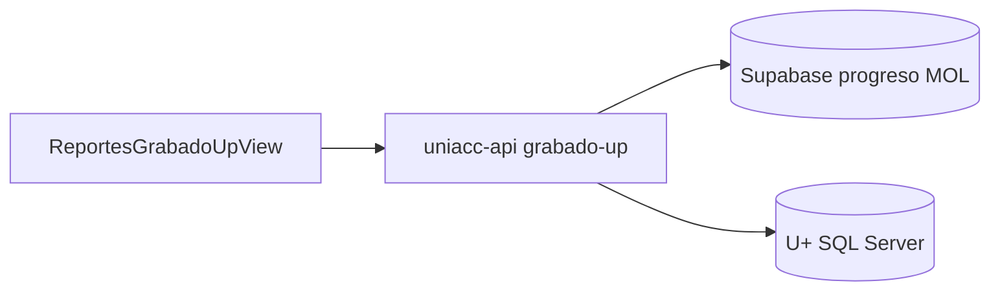

# Reportes Técnico: Grabado U+

**Fecha:** 2026-11-05  
**Estado:** aprobado (diseño v1)  
**Proyecto:** mol-docker + uniacc-api (lectura SQL Server U+)  
**Rollout:** mol-dev → uniacc-mol tras pedido explícito  

## Problema

Tras firma/matrícula, operaciones necesita ver si el alumno quedó **realmente grabado en U+** (tablas de cuenta y control), no solo en etapa MOL. Casos como UI en error con contrato firmado requieren auditoría por `NUM_OPERACION` de cuenta.

## Decisiones

| Tema | Decisión |
|------|----------|
| Menú | Reportes → **Técnico** (grupo) → **Grabado U+** |
| Universo | Matriculados MOL del periodo (excluye canal BO), igual que otros reportes |
| Semáforo v1 | Solo estado U+ (no cruce vs borrador MOL) |
| Datos | Lectura **en vivo** U+ vía uniacc-api |
| Escritura | Ninguna |
| Op. mostrada | `NUM_OPERACION` de **cuenta** (no confundir con op TuFirma) |

## Menú

```
Reportes
├── Pagos rematrícula
├── Becas asignadas
├── Tiempos por tramo
└── Técnico                          (bo_menu_item tipo group)
    └── Grabado U+                   route: dashboard-reportes-grabado-up
```

Mismo acceso grupo 1 que el resto de Reportes.

## Universo

- Fuente lista: `mnp_progreso_rematricula` con `etapa_actual = 'matriculado'` + periodo activo.
- Excluir `mnp_matricula_cartera_canal.canal = 'BO'`.
- Puente a U+: RUT sin DV (`rut_norm` sin dígito verificador) + `ANO`/`PERIODO` y/o `NUM_OPERACION` resuelto desde control/cuenta o logs MOL de cuenta (`cuenta` / `control_matricula` / grabar).

**CODCLI en U+ cuentas:** RUT sin DV.  
**Código académico** solo para contexto MOL / ficha; no es la PK de las tablas de cuenta.

## Semáforo U+ (v1)

| Estado | Regla |
|--------|--------|
| **OK** | Existe `MT_CONTROL_MATRICULA` con `ESTADO='OK'` para CODCLI+ANO+PERIODO **y** al menos una fila de cuenta ligada (`MT_CTAPAG` o `MT_CTADOC` o `MT_DOCITEM` con el mismo `NUM_OPERACION` o mismo CODCLI+periodo). |
| **Incompleto** | Hay control sin cuentas, o cuentas sin control OK, o control con estado distinto de OK. |
| **Sin op** | Matriculado MOL sin `NUM_OPERACION` resoluble en U+ para el periodo. |

`MT_POSBEN`: se muestra en detalle; en semáforo v1 no bloquea OK si no hay becas (si hay filas POSBEN se listan; ausencia no fuerza Incompleto salvo que más adelante se cruce con MOL).

## UI

### Lista

Columnas: Alumno + RUT · Carrera · Op. cuenta · Control (badge) · Semáforo · Fecha matrícula.

Filtros: carrera, búsqueda (RUT/nombre/op), chips Todos / OK / Incompleto / Sin op.

Acción fila: abrir detalle.

Export CSV de la lista filtrada.

### Detalle

Ruta hija o drawer: `/dashboard/reportes-grabado-up` + panel detalle por `numOperacion` (query o subruta).

Seis bloques (acordeón / tabs), solo lectura:

1. **MT_CONTROL_MATRICULA** — ESTADO, FECHA, USUARIO, NUM_OPERACION, CODCARR, ANO, PERIODO  
2. **MT_CTAPAG** — CTAPAG, CTAPAGNUM, MONTO, SALDO, ESTADO, GLOSA  
3. **MT_CTADEP** — CTADOC/CTADOCNUM, CTAPAG/CTAPAGNUM, MONTO  
4. **MT_CTADOC** — CTADOC, CTADOCNUM, ITEM, CUOTA, MONTO, SALDO, ESTADO  
5. **MT_DOCITEM** — ITEM (1 matrícula / 2 arancel), MONTO, CTADOCNUM  
6. **MT_POSBEN** — CODBEN, PORC_APR, MONTO, ESTADO, FECASIG  

Nota visible: «Op. cuenta U+; puede diferir de la operación TuFirma.»

## API (uniacc-api)

Solo lectura contra U+ (mismo pool/SP ambiente que grabar plan).

- `GET /api/rematricula/reportes/grabado-up?anio=&semestre=&carrera=&q=`  
  → filas lista + semáforo + `num_operacion` si existe.

- `GET /api/rematricula/reportes/grabado-up/detalle?anio=&semestre=&numOperacion=`  
  (o `codcli` RUT si aún no hay op)  
  → objeto con arrays por tabla.

Timeouts acotados; errores U+ → mensaje operable sin tumbar el tablero.

Front: vista `ReportesGrabadoUpView.vue` + servicio API; patrón visual de reportes existentes.

## Arquitectura



## Fuera de alcance (v1)

- Cruce vs borrador MOL / Webpay / becas esperadas (posible v2).
- Lectura/escritura `MT_ALUMNO`.
- Sync ETL a Supabase de las 6 tablas.
- Corrección automática de grabados incompletos.

## Criterios de éxito

- Menú Técnico → Grabado U+ visible con el mismo acceso que Reportes.
- Alumno con control OK y CTAPAG aparece **OK**; alumno solo MOL sin filas U+ aparece **Sin op** o **Incompleto**.
- Detalle muestra filas reales de las 6 tablas para una op conocida (p. ej. caso operativo reciente).
- Prod solo tras OK en mol-dev y pedido explícito.
