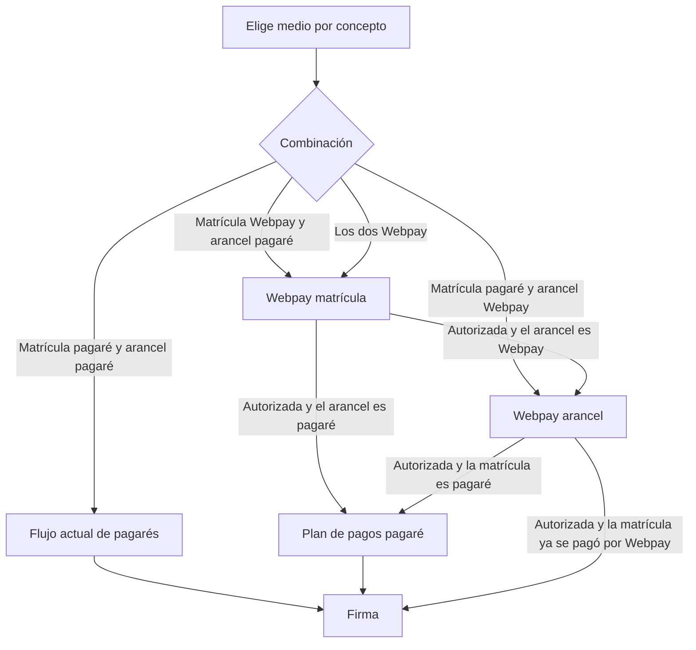

# Webpay Plus en MOL

Fecha: 2026-10-01  
Proyecto: `mol-docker` + `uniacc-api-docker`  
Estado: flujo de referencia. El diseño acordado está en [`docs/superpowers/specs/2026-10-01-webpay-plus-design.md`](superpowers/specs/2026-10-01-webpay-plus-design.md).  
Fuente: [Referencia API Webpay Plus](https://www.transbankdevelopers.cl/referencia/webpay#webpay-plus_1) y [documentación Webpay Plus](https://www.transbankdevelopers.cl/documentacion/webpay-plus).

Este archivo describe las operaciones de Transbank y el recorrido del alumno. El spec es el que se implementa.

## Decisiones ya tomadas

| Tema | Decisión |
| --- | --- |
| Producto | Webpay Plus (una transacción normal por cobro). No es Mall ni captura diferida. |
| Qué se cobra | Matrícula y arancel por separado. Cada uno puede ser Webpay o pagaré. |
| Una transacción por concepto | Si ambos van por Webpay, Transbank recibe dos transacciones. |
| Orden | Si hay Webpay, ese cobro va primero. Con los dos en Webpay, la matrícula va antes que el arancel, porque suele ser el monto menor. El plan de pagaré se arma después de que el Webpay quedó autorizado. Los dos en pagaré siguen el flujo actual. |
| `buy_order` | `{codcli}{anio}-{periodo}-{correlativo}`, sin el carácter `+`. Ejemplo: `123456782027-1-15`. Máximo 26. El correlativo lo asigna MOL al crear la fila (1, 2, 3…), uno distinto por intento. No usa el peek de `CORRPAGNUM`. |
| Firma | Se habilita cuando cada concepto marcado como Webpay está autorizado. |
| Arancel abortado o rechazado | La matrícula autorizada se conserva. Solo se reintenta el arancel, con una orden nueva. |
| Persistencia | El resultado queda en MOL (tabla en Supabase). El ERP se escribe después, en el cierre de matrícula. |
| Dónde vive la llamada | Rutas en `uniacc-api`, bajo `/api/rematricula/alumno/webpay`. El navegador no llama a Transbank. |
| Ambiente de esta entrega | Integración (`https://webpay3gint.transbank.cl`), con tarjetas de prueba. |
| Producción | Código de comercio `597053102249`. Queda en el servidor y no se usa mientras el ambiente sea integración. Host de producción: `https://webpay3g.transbank.cl`. |

Credenciales de integración públicas de Transbank (código de comercio `597055555532` y su llave) viven solo en variables de entorno del API. No van en el frontend ni en este archivo.

## Piezas

1. **Cliente Transbank en `uniacc-api`.** Crea, confirma y, si el regreso es ambiguo, consulta estado. Anular existe en la API y no entra en el flujo del alumno.
2. **Tabla en Supabase.** Una fila por transacción: concepto `matricula` o `arancel`, RUT, monto, orden de compra, token, estado (`creada`, `autorizada`, `rechazada`, `abortada`) y código de autorización. Un pagaré no crea fila.
3. **Rutas** `POST /api/rematricula/alumno/webpay/crear` y `POST /api/rematricula/alumno/webpay/retorno`.
4. **MOL.** El diálogo real ofrece Webpay o pagaré por concepto. Webpay pide crear, redirige y, al volver, pide confirmar.

El monto es el neto que la pantalla ya muestra para ese concepto. El API lo guarda y se lo envía a Transbank. Al confirmar, solo acepta la autorización si Transbank devuelve ese mismo monto.

## Operaciones que usa MOL

Todas piden los headers `Tbk-Api-Key-Id` (código de comercio) y `Tbk-Api-Key-Secret` (llave). Canal TLS 1.2.

### 1. Crear

`POST /rswebpaytransaction/api/webpay/v1.2/transactions`

```json
{
  "buy_order": "ordenCompra12345678",
  "session_id": "sesion1234557545",
  "amount": 10000,
  "return_url": "https://mol-dev.uniacc.cl/..."
}
```

| Campo | Límite | Uso en MOL |
| --- | --- | --- |
| `buy_order` | 26. Único. Letras, números y algunos signos. Sin acentos. | Una orden nueva por intento. |
| `session_id` | 61. Uso interno. Transbank lo devuelve al final. | Identifica al alumno y al concepto. |
| `amount` | Entero en pesos. Largo máximo 17. | Neto del concepto. |
| `return_url` | 256. | Ruta de MOL. No habla con Transbank. |

Respuesta `200`:

```json
{
  "token": "e9d555262db0f989e49d724b4db0b0af367cc415cde41f500a776550fc5fddd3",
  "url": "https://webpay3gint.transbank.cl/webpayserver/initTransaction"
}
```

MOL redirige al alumno con un formulario `POST` hacia `url`, con un input oculto `token_ws` igual al `token`. La fila queda `creada`.

### 2. Confirmar

Cuando el regreso trae solo `token_ws`, el API confirma:

`PUT /rswebpaytransaction/api/webpay/v1.2/transactions/{token}`

El token va en la URL, no en el body. Respuesta de un pago aprobado:

```json
{
  "vci": "TSY",
  "amount": 10000,
  "status": "AUTHORIZED",
  "buy_order": "ordenCompra12345678",
  "session_id": "sesion1234557545",
  "card_detail": { "card_number": "6623" },
  "accounting_date": "0522",
  "transaction_date": "2019-05-22T16:41:21.063Z",
  "authorization_code": "1213",
  "payment_type_code": "VN",
  "response_code": 0,
  "installments_number": 0
}
```

MOL trata como autorizado solo si `status` es `AUTHORIZED`, `response_code` es `0` y `amount` coincide con el monto guardado. En ese caso la fila pasa a `autorizada` y se guardan el código de autorización, la fecha, los últimos 4 dígitos y el tipo de pago.

`response_code` distinto de `0`, o `status` `FAILED`, deja la fila en `rechazada`.

`vci` es información de autenticación. MOL no lo usa para aceptar o rechazar el pago.

Estados que puede devolver Transbank: `INITIALIZED`, `AUTHORIZED`, `REVERSED`, `FAILED`, `NULLIFIED`, `PARTIALLY_NULLIFIED`, `CAPTURED`.

Tipos de pago: `VD` débito, `VN` crédito, `VC` cuotas, `SI` 3 cuotas sin interés, `S2` 2 cuotas sin interés, `NC` N cuotas sin interés, `VP` prepago.

### 3. Estado

`GET /rswebpaytransaction/api/webpay/v1.2/transactions/{token}`

Misma forma de respuesta que confirmar. Sirve si el regreso no trae un resultado claro o si confirmar ya se hizo y el alumno vuelve a cargar la página. No reemplaza a confirmar en el flujo normal.

### 4. Reversar o anular

`POST /rswebpaytransaction/api/webpay/v1.2/transactions/{token}/refunds`

```json
{ "amount": 1000 }
```

Respuesta con `type` `REVERSED` o `NULLIFIED`. En una anulación (`NULLIFIED`), `response_code` `0` indica que se hizo. Fuera del flujo del alumno: si el arancel se aborta, la matrícula autorizada no se anula sola.

La captura diferida (`PUT .../transactions/{token}/capture`) no aplica a este cobro.

## Regreso del alumno a MOL

La `return_url` es la ruta `matricula-alumno-webpay-retorno`, dentro de la matrícula del alumno. Acepta `GET` y `POST`: el pago normal vuelve por `GET` y el aborto en integración vuelve por `POST`. Esa ruta no habla con Transbank. Lee los parámetros y llama a `/api/rematricula/alumno/webpay`.

El login de MOL está en `sessionStorage`. El redirect a Webpay es en la misma pestaña, así que la sesión sigue al volver. Si no está, MOL guarda `token_ws` o los `TBK_*` y manda al login. Al entrar de nuevo, retoma la confirmación. La fila en Supabase no depende de que la pestaña haya seguido abierta.

| Qué pasó | Qué llega a `return_url` | Qué hace MOL |
| --- | --- | --- |
| Flujo normal y Transbank autoriza | Solo `token_ws`. Confirmar devuelve `AUTHORIZED` y `response_code` `0`, y el monto coincide. | Fila `autorizada`. Muestra que ese concepto quedó pagado y sigue solo: si el otro es Webpay, arma la segunda transacción y redirige; si es pagaré, abre el plan de pagos. No vuelve a pedir el medio. |
| Flujo normal y Transbank rechaza | Solo `token_ws`. Confirmar no cumple la regla de arriba. | Fila `rechazada`. Dice que el pago no se completó y ofrece reintentar ese concepto. El paso siguiente no se arma. |
| Timeout (10 min en integración, 4 min en producción) | Solo `TBK_ID_SESION` y `TBK_ORDEN_COMPRA`. No llega token. | Fila `abortada`. No confirmar. El mismo mensaje de reintento. |
| El alumno anula en el formulario | `TBK_TOKEN`, `TBK_ID_SESION`, `TBK_ORDEN_COMPRA`. El token no se llama `token_ws`. | Consultar estado con `TBK_TOKEN`. No confirmar. Fila `abortada` y reintento. |
| Error en el formulario y "volver al sitio" | `token_ws`, `TBK_TOKEN`, `TBK_ID_SESION`, `TBK_ORDEN_COMPRA` | Consultar estado. No confirmar a ciegas. Si Transbank no la tiene autorizada, se trata como `abortada`. |

`TBK_ORDEN_COMPRA` es el `buy_order`. `TBK_ID_SESION` es el `session_id`.

Si el alumno recarga el regreso, MOL no vuelve a confirmar en Transbank. Si la fila ya está `autorizada`, `rechazada` o `abortada`, muestra ese resultado. Si confirmar responde que la transacción ya fue confirmada, el API consulta el estado y guarda una sola vez.

## Secuencia en MOL

Hay cuatro combinaciones. Si uno de los dos conceptos es Webpay, ese cobro ocurre antes del plan de pagaré. El plan de pagaré no se genera hasta que el Webpay de esa combinación quedó `autorizada`.



1. **Matrícula pagaré y arancel pagaré.** Sigue el flujo actual. No hay filas de Webpay.
2. **Matrícula Webpay y arancel pagaré.** Primero Webpay de la matrícula. Si queda `autorizada`, se genera el plan de pagos del arancel.
3. **Matrícula pagaré y arancel Webpay.** Primero Webpay del arancel. Si queda `autorizada`, se genera el plan de pagos de la matrícula.
4. **Matrícula Webpay y arancel Webpay.** Primero la transacción de matrícula, que suele ser el monto menor. Si queda `autorizada`, se crea la transacción de arancel. La firma espera las dos filas `autorizada`.

Si en el caso 4 la matrícula quedó `autorizada` y el arancel vuelve `abortada` o `rechazada`, la fila de matrícula no se toca. El reintento del arancel crea otra orden. Si el primer Webpay no queda `autorizada`, no se arma el paso siguiente.

## Fila de la transacción

La tabla es `mnp_webpay_transaccion` en Supabase. Solo la escribe `uniacc-api`, por su conexión a Postgres. El navegador no lee ni inserta esa tabla. El alumno la ve a través de las rutas `/api/rematricula/alumno/webpay`.

Cada intento es una fila. Un reintento no reutiliza la orden anterior. Al crear un intento nuevo del mismo concepto, la fila anterior que siga en `creada` pasa a `abortada`.

`buy_order` es `{codcli}{anio}-{periodo}-{correlativo}`. El correlativo es un entero que MOL asigna al insertar la fila, único en la tabla. Matrícula y arancel quedan, por ejemplo, `123456782027-1-15` y `123456782027-1-16`.

`session_id` repite al alumno y el intento para que Transbank lo devuelva: `{codcli}-{anio}-{periodo}-{concepto}-{correlativo}`. Cabe en 61. Ejemplo: `12345678-2027-1-matricula-15`.

| Columna | Qué guarda |
| --- | --- |
| `buy_order` | Orden única enviada a Transbank. |
| `session_id` | Identificador interno que Transbank devuelve igual. |
| `concepto` | `matricula` o `arancel`. |
| `codcli`, `anio_periodo`, `semestre_periodo` | El alumno y el periodo de esa matrícula. |
| `correlativo` | Entero asignado por MOL. |
| `monto` | El neto enviado a Transbank. |
| `token` | El de crear. |
| `estado` | `creada`, `autorizada`, `rechazada` o `abortada`. |
| `authorization_code`, `response_code`, `payment_type_code`, `card_last4`, `transaction_date` | Lo que devuelve confirmar, cuando existe. |
| `ambiente` | `integracion` en esta entrega. |

La fila `autorizada` no se convierte en documento del ERP en este paso. Eso queda para el cierre de matrícula. La pantalla mock de WebPay, Pagaré y TOKU no participa: el medio se elige en el diálogo real.

## Pruebas

1. **`uniacc-api`, sin red.** El `buy_order` no pasa de 26 caracteres. Confirmar rechaza un monto distinto al guardado. Timeout y anulación no llaman a confirmar. Una recarga no confirma dos veces. Un segundo intento del mismo concepto deja la fila `creada` anterior en `abortada`.
2. **Integración de Transbank, a mano, con tarjetas de prueba.** Un pago autorizado, un rechazo y una anulación en el formulario. No corre en CI.
3. **MOL.** Las cuatro combinaciones eligen el paso siguiente sin entrar a Transbank.

El momento en que la fila `autorizada` se convierte en documento del ERP queda fuera de esta entrega.
